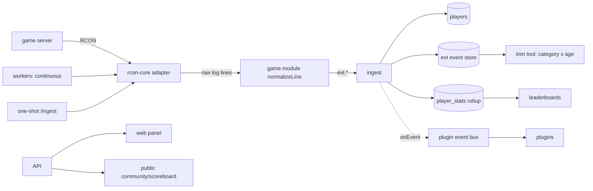

# Architecture Overview

How the pieces fit together, the data flow, and the invariants that keep it maintainable. For
logging/errors see `docs/observability.md`; for what the game server itself exposes see `docs/rcon-503.md`, and for CRCON's API (imports and
reference only) `docs/crcon-api.md`.

## Principles (the load-bearing decisions)

1. **API-first.** Every capability lives behind the `api`. The web panel, the (future) app, and Discord
   are all *clients*. The system runs with **zero Discord**; identity is the system's own accounts +
   tokens, with OAuth linking optional.
2. **One game-I/O path.** Only `rcon-core` opens a game socket. Everything else speaks *logical*
   commands and reads `evt.*` events — never a wire protocol or a raw log line.
3. **Safe by construction.** A server's **engagement mode** (`observe` | `active`) is enforced below the
   command layer: `observe` blocks every write *before* it reaches the wire, so we run safely beside an
   existing RCON tool. Per-server **RBAC** gates who can do what, on which server.
4. **Data-driven & pluggable.** RCON commands live in a registry (per protocol/game); log parsing is
   normalization rules; the UI is widgets arranged by a layout; features are plugins. New games,
   protocols, widgets, and modules are *added as data/modules*, not surgery.
5. **Traceable.** Structured logs, typed errors, and a request id on every response.

## Components

```
packages/shared      config · structured logger · typed error taxonomy (AppError, request ids)
packages/events      the evt.* event taxonomy (game-agnostic)
packages/games       game modules: command tables, log normalizers, domain descriptors (HLL built in)
packages/rcon-core   protocol adapters (binary-v2 / legacy-text / crcon-bridge) + engagement guard — game-agnostic, tables injected
packages/access      password hashing, API tokens, sessions, per-server RBAC (resolveLevel/can)
packages/db          entities + Repository interface (in-memory + Postgres) + SQL migrations
packages/ingest      lines -> normalizer -> upsert players + insert events + bump stat rollups
packages/bus         live event distribution (Redis pub/sub with an in-process fallback)
packages/schedule    pure window/profile matcher (time · days · dates · player/team counts) — auto settings + map-vote profiles
packages/maps        map catalogue inference, rotation placement (scheduleNextMap), vote engine (buildPoll/resolveVoteWinner)
packages/rules       the player-rules framework behind Auto settings (module contract, escalation ladder, built-in modules)
packages/widgets     WidgetDef/registry + resolveLayout (defaults <- saved overrides)
packages/plugin-sdk  PluginManifest + capability-scoped PluginHost runtime

apps/api             REST API; serves the exported panel; builds the plugin runtime (host+registry+bus)
apps/workers         five continuous loops per server (ingestion · seeding · map vote · broadcast · auto settings) + expiry sweeps
apps/panel           the web panel — Next.js (App Router), static-exported to out/ and served by the API
apps/discord         Discord relay bot (bus consumer → Discord channels)

plugins/*            plugins built on plugin-sdk (example-killfeed dogfoods it)
```

## Data flow: from the game server to stats



- **Two ingestion drivers:** `apps/workers` (always-on, one persistent connection per server) and the
  API's one-shot `POST /api/servers/:id/ingest` (handy for testing).
- **Stats are accumulated at ingest**, in `player_stats` — *not* recomputed from `evt`. That is what
  makes trimming safe.

## Request lifecycle (API)

`createHandler` assigns a **request id** (→ `x-request-id` header + every error body + a bound logger),
matches a route, and runs its handler. Handlers `throw` typed errors (`errors.notFound()`,
`errors.forbidden()`, `errors.upstream()`…); the central handler maps them to `{ error: { code, message,
requestId } }`, logging 5xx with a full stack and 4xx as warnings. Auth resolves a Bearer token (session
or API token) to a principal; RBAC checks use `can(grants, capability, level, { serverId })`.

**Admin actions** (`POST /servers/:id/actions`: message / kick / punish / temp+perma ban / unban) require
the `server.actions` write capability and map to logical RCON commands. Because those are all *writes*,
the engagement guard refuses them on `observe` servers (→ 409) — so an observe server can never touch the
game, the same invariant that lets CRCON keep running untouched alongside. The v2 command bodies
(`PlayerId`, `Message`, `Reason`, `Duration`, `AdminName`) and the players-roster field `iD` are the
game's own API shapes, cross-checked against CRCON.

## Plugin runtime

How it works inside, for work on the panel itself; to write a plugin, see [plugins.md](plugins.md).

`apps/api/src/plugin-host.ts` builds a `PluginHost` with **real providers**: the event bus
(`@app/bus`), the widget registry (seeded with first-party widgets), DB-backed **namespaced**
storage, and rcon-core (engagement mode still applies). A plugin declares capabilities in its manifest
and receives a `host` exposing **only those** — undeclared namespaces are absent. Plugin widgets register
into the **same** registry the layout system renders, so third-party modules are first-class in the UI.
Beyond the built-ins, `PLUGINS_DIR` is scanned at startup (`plugin-discovery.ts`) and any folder- or
file-based plugins found there load through the same host. In Docker it is the `installed-plugins`
folder, mounted read-only into the api; the start scripts pull each plugin there that is a git clone
and pass what they found as `PLUGINS_STATE`, so a change recreates the api — a discovered plugin is no more privileged
than a built-in one, and a malformed one is logged and skipped without blocking startup.

A plugin can carry a whole feature's API, each part behind its own capability:

- `api:routes` — routes under `/api/plugins/<id>/…` (`routes/plugins.ts`, `plugin-http.ts`). The host
  signs every caller in before the handler runs; the plugin asks `viewer.holds(...)` for its own
  permissions. A `stream` route is server-sent events: `?token=` signs an EventSource in, and every
  heartbeat signs the viewer in again and asks the plugin's `recheck`, so a revoked permission or an
  ended session closes the stream within a beat. Cookies are the plugin's own (HttpOnly, SameSite,
  scoped to its path, Secure over HTTPS).
- Manifest `permissions` — added to Roles as `<id>.<key>` (`plugin-permissions.ts`), validated and
  guarded like the core catalogue, never in a preset; `outright` ones count only when held on the
  account itself everywhere, and only such a holder can hand them out. A clash with an existing
  permission refuses the plugin, and a plugin that fails part-way leaves nothing registered. While
  a plugin is not running its grants stay as stored: a save that re-sends them goes through, nothing
  new can name them, and the outright guards treat them as outright.
- `game:live` — held read connections to a game server, and the game's own knowledge (sides, team
  resolution, player ids) from the host, so a plugin never carries a copy that goes stale.
- `events:read`, `audit`, `secrets` — the stored game log, the staff trail (filed as
  `<id>.<action>`), and sealing and signing under the install's encryption key.
- `commands` — host commands for what must never be done from the panel, run in the api container
  with `node apps/api/dist/plugin-command.js <id> <command>`.
- `unlisted` — kept out of the plugin list every staff member can read, and its count, except for those who may open one of its pages.

Capabilities scope what the host hands a plugin; they are not a sandbox. A plugin runs inside the
API's process, so installing one is trusting it.

**Widget-rendering bridge.** A plugin contributes real browser UI *as data*, never as code: its
`registerWidget` includes a declarative `view` of known block types (`stat`, `table`, `feed`,
`markdown`). Live/summary data comes from `provideData(key, fn)` — a server-side provider the host
namespaces per plugin and the API exposes at `GET /api/plugins/:id/data?key=…`; the host stamps the
registering plugin's id onto the widget so the panel knows where to fetch. The panel's `WidgetRenderer`
maps each block to React — `stat`/`table` fetch the plugin provider (optionally on a refresh interval),
`feed` streams live events over the same SSE bus. Nothing crosses the boundary but JSON, so a widget
runs no plugin code in an admin's browser. The example kill-feed dogfoods it (a server-side "total
kills" stat + a live kill feed).

**Plugin pages.** A widget is data; a page (`ui:page`) is code — a whole screen, for what blocks
cannot express. The API lists to each viewer only the pages they may open (`GET /api/plugin-pages`)
and sends a page's code only to them (`GET /api/plugin-pages/<plugin>/<page>`): to anyone else its
address has nothing at it, and the code is never in the panel's bundle. The panel adds the listed
pages to the route registry (sidebar section, palette, tab title, role previews) and draws one in
place: the module's default export is a React component, rendered with the panel's own React and
built against `react` and the page kit (`apps/panel/lib/pluginKit.ts`: the api client, the UI
components, game assets, navigation) as externals read from `globalThis.__hellrconPageKit`. A page
runs with the viewer's session, so it is exactly as trusted as the plugin's server half.

The **event bus** has one interface, two backings (`createEventBus` chooses by `REDIS_URL`): an
`InProcessEventBus` (synchronous, single process) and a `RedisEventBus` (Redis pub/sub on the
`the panel:evt` channel). This is what carries live activity across processes — the always-on worker
`emit`s each newly-stored event; the API subscribes and dispatches to plugin handlers — so a kill on
the game server reaches the kill-feed plugin loaded in the API. Publishing is fire-and-forget: a Redis
hiccup never blocks or fails ingestion.

## Protocol adapters

All three `RconProtocol`s implement the same `RconAdapter`, so everything above rcon-core is
protocol-blind and logical commands resolve through the registry:
- **binary-v2** — HLL's current binary API (magic/legacy framing), the primary path.
- **legacy-text** — HLL's older text protocol over an XOR-framed TCP socket (the server sends the
  key on connect; every message is XOR'd with it). Logical commands map to `legacyText` registry
  wires (`Get PlayerIds`, `ShowLog`, `Kick`/`Ban`/`Message`…); unsupported ones fail with a clear
  error. Reads parse the tab/newline responses; writes expect `SUCCESS`.
- **crcon-bridge** — reads a server *through an existing CRCON's* HTTP API (`Authorization: Bearer`
  API key), so a community already running CRCON is sourced with zero extra RCON sockets. Log lines
  come back as CRCON's `raw` field — the original game text — feeding the same normalizer. It is
  `canWrite = false`: writes are refused here regardless of engagement mode.

Log tailing is uniform: each adapter polls recent lines and emits only newly-seen ones (deduped by
`logLineKey`, stable as the relative-time prefix changes across polls).

## Protected invariants (guarded by tests — do not weaken)

- **Trim-safety:** deleting every raw `evt` row leaves career stats unchanged
  (`packages/ingest/test` — the `[INVARIANT]` test).
- **Observe = read-only:** a server not explicitly `active` cannot issue a write command
  (`packages/rcon-core` engagement guard + tests).
- **Capability scoping:** a plugin cannot access a capability it didn't declare
  (`packages/plugin-sdk/test`).
- **Secrets never leave:** server RCON passwords and password hashes are stripped from all API responses
  (`db` `toPublicServer`, `access` tests).
- **No raw control characters in source** — a literal NUL makes a file read as binary to grep, so it silently drops out of repo-wide searches (CI `check:naming`).

## Deployment

Same artifacts, config-chosen topology: **local** = one `docker compose` (Postgres + Redis + api +
worker + discord); **hosted** = the same services split out and `workers` scaled. Nothing is hardcoded —
hosts, ports, secrets, and tenancy come from env/config. Storage is the `Repository` interface: in-memory
for dev, Postgres in production (`createRepository` picks by `DATABASE_URL`).

The **Discord relay** (`apps/discord`) is another bus consumer: it subscribes over Redis and posts live
activity to Discord channels, batching a few seconds of events into one message per channel (so a busy
kill feed can't trip Discord's rate limit). Formatting and routing are pure and unit-tested; the
transport is the Discord REST API (no gateway — the bot only sends), behind a `MessageSink` interface.
Categories (kills/chat/admin/connections/match) route to per-category channels or a default, and default
to a low-noise set. Until a bot token is set in the panel (Discord → Setup & status) it waits for
one, without crash-looping, and starts relaying once it is saved. Inbound
slash commands (which need the gateway) are a later increment.

## Known gaps / next steps

- Not yet validated against a **live** HLL server — the `GetAdminLog` content shape and the normalizer's
  log-line regexes are best-effort and will be tuned against real output.
- The **panel** is a Next.js App-Router SPA (`apps/panel`), statically exported to `out/` and served by
  the API — no separate Next server, same single-container model. Its nav is driven by the widget/layout
  API (`/api/layout/admin`, reorder + show/hide, per-user or instance scope), and every panel-based
  screen persists its own arrangement (order, widths, hidden, collapse) through the same API under a
  `panel:<viewId>` surface — the server stores the choices verbatim (strictly parsed, capped per
  account) and the panel resolves them against whatever it actually mounts; plugin-provided views show
  a placeholder until the widget-rendering bridge lands (a plugin can't yet ship browser UI). It streams
  **live events** via `GET /api/events/stream` (SSE over the bus; token in `?token=` since EventSource
  can't set headers, `?serverId=` scopes it), issues admin actions against the actions API, and renders
  plugin widget views through the widget-rendering bridge (declarative blocks; see the plugin runtime).
- The declarative widget vocabulary is intentionally small (`stat`/`table`/`feed`/`markdown`); richer
  block types (charts, forms that call the actions API, per-server scoping) extend the same data-driven
  contract without a plugin ever shipping browser code.
- RCON command/log shapes are registry data, not code, so new games/versions are added as tables.
